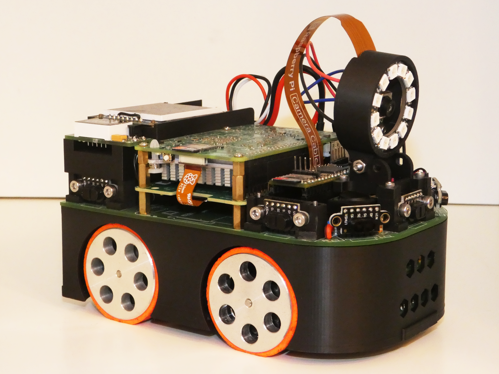
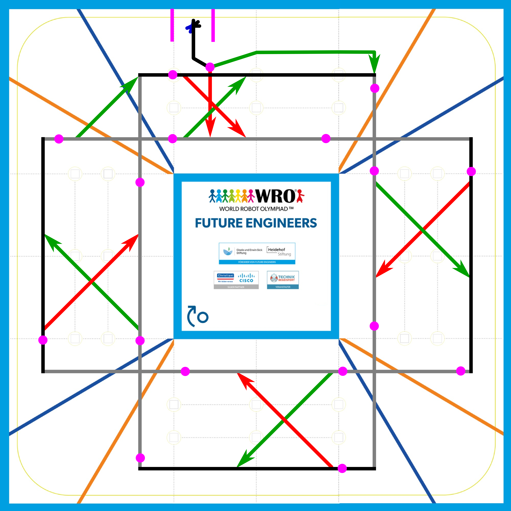
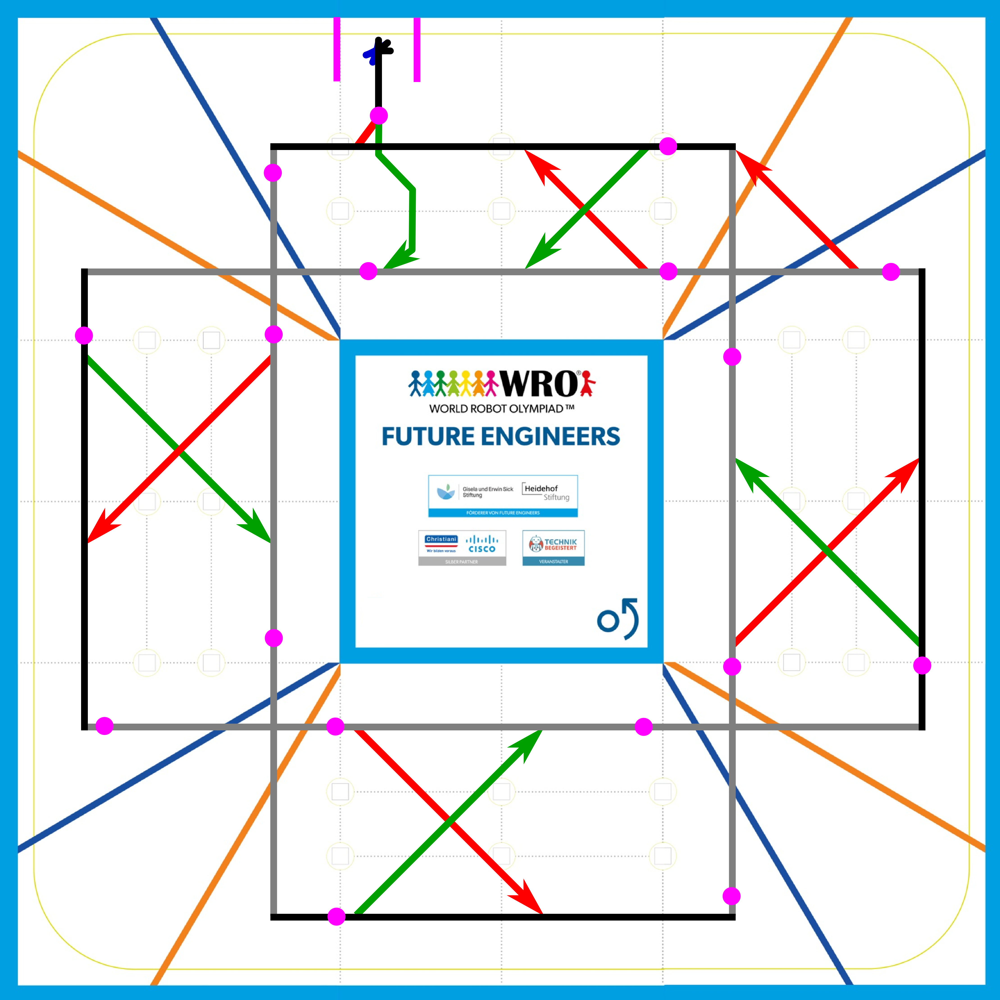

# WRO2026 Future Engineers - Team TerraForce

This repository contains engineering materials of our self-driven vehicle's model participating in the WRO Future Engineers competition in the season 2026:<br><br>


## Content
The structure of this repository is based on the [official repository template](https://github.com/World-Robot-Olympiad-Association/wro2022-fe-template):
- [`t-photos`](/t-photos/) contains 2 photos of our team (an [official](/t-photos/official.png) one and one [funny](/t-photos/funny.png) photo with all our team members)
- [`v-photos`](/v-photos/) contains 6 photos of the vehicle (from every side, top and bottom)
- [`video`](/video/) contains the [video.md](/video/video.md) file with the link to a video where driving demonstration exists
- [`schemes`](/schemes/) contains schematic diagrams of all PCBs and an [overview over the power tree](/schemes/energy.png)
- [`src`](/src/) contains the control software source code for all components which were programmed to participate in the competition
- [`models`](/models/) contains 3D models of the 3D-printed vehicle parts and other helpful tools
- [`other`](/other/) contains a [description of how to prepare the vehicle for the competition](/other/preparation.md) including [hardware assembly](/other/preparation.md#hardware-assembly) and [software preparation / upload](/other/preparation.md#software-preparation); this directory also includes a description of our [communication protocols](/other/protocols.md) and additional information about the [hardware](/other/hardware.md), as well as the [engineering journal](/other/engineering_journal.pdf)

## Introduction
Our self-driven vehicle has been developed as a direct sucessor to the vehicle we built for the [last season](https://github.com/TerraForces/WRO2025-Future-Engineers) of this competition. The hardware has been redesigned completely to solve the problems that we encountered during the last season while keeping in mind the things we learned from both previous seasons we participated in:

problem of the last vehicle | solution
-|-
<b>high center of mass:</b> because of the high mechanical layer, the heavy battery had been placed relatively high which risked falling over in sharp turns | reduced height of the mechanical layer, significantly lower battery weight and size because of the switch to lithium-ion batteries
<b>dust/hair accumulation:</b> the open design quicky led to lots of accumulated hair increasing friction on the drive shaft and therefore decreasing the top speed while increasing motor power usage | closed chassis with small openings for wheels, color sensor and ventilation
<b>low top speed:</b> we were not able to compete with the speeds of other vehicles in the open challenge, even at maximum power | gear ratio changed from ≈84.5:1 to ≈55.3:1, increasing the theoretical top speed from ≈0.504 m/s to ≈0.77 m/s
<b>battery not easily exchangeable:</b> the battery pack was locked between PCBs, unplugging and plugging in the connector was very difficult since it has been placed below the main PCB and behind the main switch and charging port | plug easily accessable at the side of the vehicle with no layer above, battery pack slides out easily below the LCD
<b>mechanical components not easily accessable:</b> cleaning the bearings or changing the wheels required a complete disassembly of the drive shaft | wheels can be removed with a single screw below the silicon
<b>lights too weak:</b> the LEDs were too weak to properly light the next traffic signs in dark conditions | the LED ring has 12 strong LEDs which can light large spaces and can also be used a debug display
<b>slow braking:</b> the braking effect due to fricton in the gears was too weak to stop the vehicle precise enough | active motor brake (relay connecting both poles over a resistor)
<b>side distance sensors too far back:</b> distance changes (activates curves) on the side of the inner border were detected late which forced sharper turns | added two additional distance sensors on the side as close to the front of the vehicle as possible
<b>distance sensors outside of the vehicle outline:</b> the optical covers of all VL53L1X distance sensors (all soldered) have not been thought of during the design process; collisions during testing deform the sensor pins and change its angle | all VL53L1X sensors are completely inside of the vehicle outline, are easily removeable and most of them (except the angled sensors at the front) are being stabilized by 3D-printed mounts
<b>no line detection:</b> there was no sensor to detect the blue and orange lines on the game field | added a TCS3472 color sensor (comes with two white LEDs to light the floor) in the front of the vehicle
<b>shunt resistor burned out:</b> one of our current sensing shunt resistors burned out while operating | current measurements using ACS712 hall-effect current sensors

> [!NOTE]
> A detailed description of the complete development and testing process is given in the [engineering journal](/other/engineering_journal.pdf)

The <b>software for the [Raspberry Pi 5](/src/RPI5/main.cpp)</b> has partially remained unchanged since [last season](https://github.com/TerraForces/WRO2025-Future-Engineers/blob/master/src/WRO%20RPI5/Inference/main.cpp): we run a retrained version of the object detection AI model called [YOLO11s](https://docs.ultralytics.com/models/yolo11) using the postprocessing capabilities of [rpicam-apps](https://github.com/raspberrypi/rpicam-apps). Because the model has been trained by us with a wide variety of pictures featuring traffic signs and parking lot walls in different lighting conditions and positions, it continues working without issues with the new camera position, but it probably has to be retrained very soon with new pictures to be able to detect modified traffic signs according to the [surprise rule](https://wro-association.org/wp-content/uploads/WRO-2026-Future-Engineers-Extra-Task.pdf) which we plan to attempt.<br>
While porting the previous season's drivers code to our new MCU [Teensy 4.1](https://www.pjrc.com/store/teensy41.html), we noticed that its UART timing deviations were incompatible with the the [Raspberry Pi 5](https://www.raspberrypi.com/products/raspberry-pi-5/) at the old 112500 bps, but the UART communication works reliably at 500 kbps. This change also increases bandwith and therefore reduces latency by a bit.<br>
The autostart of the program on the Raspberry Pi 5 is now done using systemd services which are much more reliable than the .desktop solution of the last season and also reduce startup time by around 3 seconds to around 18 seconds from power on to the first detected objects arriving at the Teensy 4.1.

The development of the <b>main driving software</b> has been continued from the [last season](https://github.com/TerraForces/WRO2025-Future-Engineers/tree/master/src/WRO%20ESP32): the separation of [driving logic (main.cpp)](/src/Teensy/src/main.cpp) and [drivers core (car.cpp)](/src/Teensy/src/car.cpp) by an [API (car.hpp)](/src/Teensy/src/car.hpp) has simplified development and testing significantly and allows us team members to specialize in either driving logic or drivers development. The largest amount of code is hidden in the [lib](/src/Teensy/lib/) folder where our custom libraries are located. All external resources used during the development of these libraries can be found in [protocols.md](/other/protocols.md), together with a [description](/other/protocols.md#uart-500-khz) of our only custom protocol.<br>
The [Teensy 4.1](https://www.pjrc.com/store/teensy41.html) features only one powerful core which the driving logic and drivers have to share (in contrast to the two seperated cores in the last season), but the high clock frequency of 600 MHz (by default) allows us to run everything even faster than last season while also eliminating the RTOS overhead and any possible issues with shared memory access.<br>
The only downsides we found were that the processor now does nothing useful while waiting for requested data over I2C, which we reduced to a minimum by only requesting measurement data when the interrupt pin of the individual sensor has been pulled high, and that the [```update()```](/src/Teensy/src/car.hpp#159) function has to be called every time the measurement results should be updated, but also while waiting to keep the acceleration control and power monitoring running, prevent the UART buffer and IMU FIFO from overflowing and let the VL53L1X sensors start new measurements.

The <b>driving logic</b> of both challenges follows the same strategy as last season: following a simple path, parallel/perpendicular to the track walls to keep the laser beam of the VL53L1X ToF distance sensors perpendicular to the barriers which maximizes measurement accuracy. In the obstacle challenge, we follow one of two tracks, either next to the inner wall (<b>"inner lane"</b> - gray in the following diagrams) or the outer wall (<b>"outer lane"</b> - black in the following diagrams). The additional, angled VL53L1X sensors enable us to also drive in an angle of around 45° to the walls which we use while changing the driving side/lane in the obstacle challenge - shown as arrows in the following diagrams with the same color as the next traffic sign (colors are inverted for modified traffic signs according to the [surprise rule](https://wro-association.org/wp-content/uploads/WRO-2026-Future-Engineers-Extra-Task.pdf)):

### round 1 clockwise


### round 1 counterclockwise


### rounds 2 and 3
After recoding the traffic sign positions and colors in the first round (pink circles = evaluated photo locations), the following rounds follow a more optimized path without looking for traffic signs again:


We also tested a reaction based approach for the obstacle challenge which attempts to keep the next traffic sign centered in the camera view and drives around it when the object gets within a defined distance. While the code for this strategy was really short and simple to understand compared to the one of our fully planned route, it couldn't be modified as easily as our code where most cases are being handled seperately. The reaction based approach kept missing a few traffic signs every round and, in contrast to the planned path, the positions of traffic signs can't be saved and finding the parking position is harder because the current position is mostly unknown. We quickly decided to stay with the planned path strategy.

> [!TIP]
> We recommend reading our [engineering journal](/other/engineering_journal.pdf) for more information about the engineering process and the [preparation instructions](/other/preparation.md), which include all you need to know about [hardware assembly](/other/preparation.md#hardware-assembly) and [software preparation / upload](/other/preparation.md#software-preparation).