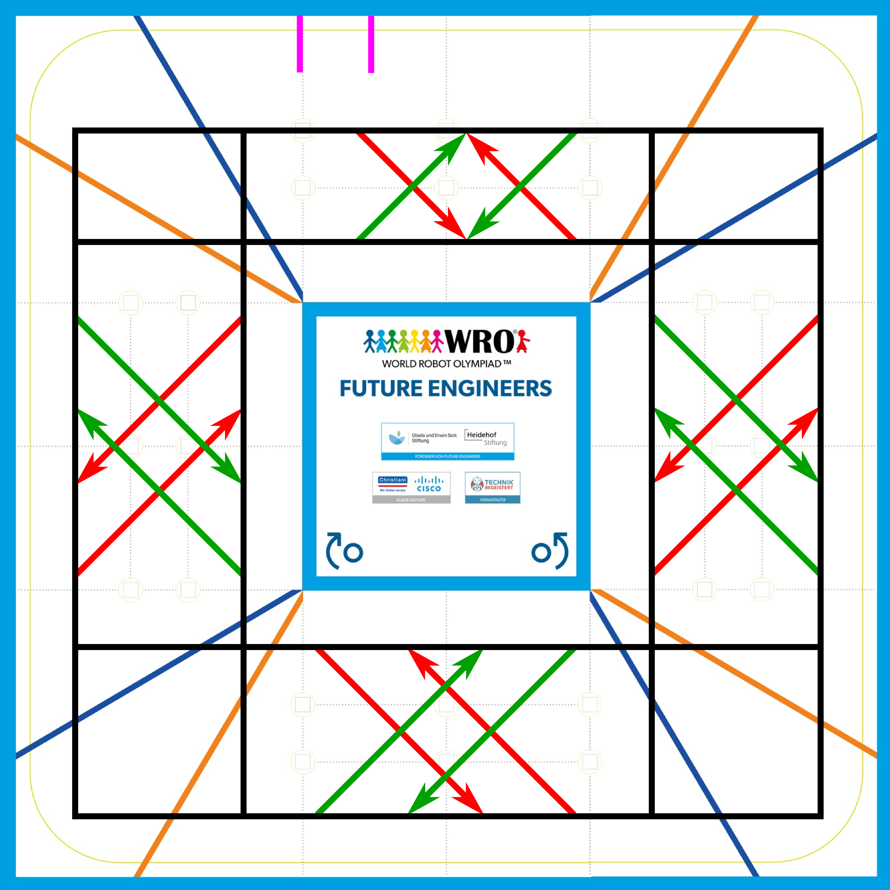

# WRO2026 Future Engineers - Team TerraForce

This repository contains engineering materials of our self-driven vehicle's model participating in the WRO Future Engineers competition in the season 2026.

## TODO
- add changelog
- add [hardware assembly](/other/preparation.md#hardware-assembly) instructions
- comment the [I2C library](/src/Teensy/lib/I2C/)
- comment the [NeoPixel update code](/src/Teensy/lib/NeoPixel/neopixel.cpp)
- extend [hardware information](/other/hardware.md)
- extend the hardware part of the introduction
- upload new videos and change links in [video.md](/video/video.md)
- rewrite IMU startup
- write engineering journal

## Content
The structure of this repository is based on the [official repository template](https://github.com/World-Robot-Olympiad-Association/wro2022-fe-template):
- [`t-photos`](/t-photos/) contains 2 photos of our team (an [official](/t-photos/official.png) one and one [funny](/t-photos/funny.png) photo with all our team members)
- [`v-photos`](/v-photos/) contains 6 photos of the vehicle (from every side, top and bottom)
- [`video`](/video/) contains the [video.md](/video/video.md) file with the link to a video where driving demonstration exists
- [`schemes`](/schemes/) contains schematic diagrams of the electromechanical components illustrating all the electronic components and motors used in the vehicle and how they connect to each other
- [`src`](/src/) contains the control software source code for all components which were programmed to participate in the competition
- [`models`](/models/) contains 3D models of the 3D-printed vehicle parts and other helpful tools
- [`other`](/other/) contains a [description of how to prepare the vehicle for the competition](/other/preparation.md) including [hardware assembly](/other/preparation.md#hardware-assembly) and [software preparation / upload](/other/preparation.md#software-preparation); this directory also includes a description of our [communication protocols](/other/protocols.md) and additional information about the [hardware](/other/hardware.md), as well as the [engineering journal](/other/engineering_journal.pdf)

## Introduction
Our self-driven vehicle has been developed as a direct sucessor to the vehicle we built for the [last season](https://github.com/TerraForces/WRO2025-Future-Engineers) of this competition. The hardware has been redesigned completely to solve the problems that we encountered during the last season:
- <b>high center of mass:</b> because of the high mechanical layer, the heavy battery had been placed relatively high in the last season which risked falling over in sharp turns; we solved this by reducing the height of the mechanical layer and significantly lowering the battery weight and size by switching to lithium ion batteries
- <b>dust/hair accumulation:</b> the open design of our last season's vehicle quickly led to lots of accumulated hairs increasing friction on the drive shaft and therefore decreasing the already relatively low top speed while increasing power usage by the motor

The <b>software for the [Raspberry Pi 5](/src/RPI5/main.cpp)</b> has mostly remained unchanged from [last season](https://github.com/TerraForces/WRO2025-Future-Engineers/blob/master/src/WRO%20RPI5/Inference/main.cpp): the object detection AI model [YOLO11s](https://docs.ultralytics.com/models/yolo11) and its execution using the postprocessing capabilities of [rpicam-apps](https://github.com/raspberrypi/rpicam-apps) have not been modified since last season. Because the model has been trained by us with a wide variety of pictures featuring traffic signs and parking lot walls in different lighting conditions and positions, it continues working without issues with the new camera position, but it probably has to be retrained very soon with new pictures to be able to detect modified traffic signs according to the [surprise rule](https://wro-association.org/wp-content/uploads/WRO-2026-Future-Engineers-Extra-Task.pdf) which we plan to attempt.<br>
While porting the old code to our new MCU [Teensy 4.1](https://www.pjrc.com/store/teensy41.html), we noticed that its UART timing deviations were incompatible with the the Raspberry Pi 5 at the old 112500 Hz, but the UART communication works reliably at 500 kHz. This change also increases bandwith and therefore reduces latency by a bit.<br>
The autostart of the program on the Raspberry Pi 5 is now done using systemd services which are more reliable than the .desktop solution of the last season and reduce startup time by around 3 seconds to 17-18 seconds from power on to the first detected objects arriving at the Teensy 4.1.

The development of the <b>main driving software</b> has been continued from the [last season](https://github.com/TerraForces/WRO2025-Future-Engineers/tree/master/src/WRO%20ESP32): the separation of [driving logic (main.cpp)](/src/Teensy/src/main.cpp) and [drivers (car.cpp)](/src/Teensy/src/car.cpp) by an [API (car.hpp)](/src/Teensy/src/car.hpp) has simplified development and testing significantly and allows us team members to specialize in either driving logic or drivers development.<br>
The [Teensy 4.1](https://www.pjrc.com/store/teensy41.html) features only one powerful core which the driving logic and drivers have to share (in contrast to the two seperated cores in the last season), but the high clock frequency of 600 MHz (by default) allows us to run everything even faster than last season while also eliminating any possible issues with shared memory access and the RTOS overhead.<br>
The only downsides we found were that the processor now does nothing useful while waiting for requested data over I2C and that the [```update()```](/src/Teensy/src/car.hpp#159) function has to be called every time the measurement results should be updated, but also while waiting to keep the acceleration control and power monitoring running, prevent the UART buffer and IMU FIFO from overflowing and let the VL53L1X sensors start new measurements.

The <b>driving logic</b> of both challenges follows the same strategy as last season: following a simple path, parallel/perpendicular to the track walls to keep the laser beam of the VL53L1X ToF distance sensors perpendicular to the barriers which maximizes measurement accuracy. In the obstacle challenge, we follow one of two tracks (either next to the inner or the outer wall - black in the following diagram). The additional, angled VL53L1X sensors enable us to also drive in an angle of around 45° to the walls which we use while changing the driving side in the obstacle challenge (arrows in the following diagram - colored by next traffic sign):<br><br>


We also tested a reaction based approach for the obstacle challenge which attempts to keep the next traffic sign centered in the camera view and drives around it when the object gets within a defined distance. While the code for this strategy was really short and simple to understand compared to the one of our fully planned route, it couldn't be modified as easily as our code where most cases are being handled seperately. The reaction based approach kept missing a few traffic signs every round and, in contrast to the planned path, the positions of traffic signs can't be saved and finding the parking position is harder because the current position is mostly unknown. We quickly decided to stay with the planned path strategy.

> [!TIP]
> We recommend reading our [engineering journal](/other/engineering_journal.pdf) for more information about the engineering process and the [preparation instructions](/other/preparation.md), which include all you need to know about [hardware assembly](/other/preparation.md#hardware-assembly) and [software preparation / upload](/other/preparation.md#software-preparation).